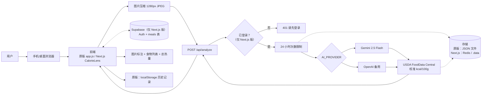

# Calorie Lens 产品开发文档

## 1. 文档目的

本文档用于指导 Calorie Lens 的产品开发、技术实现、联调测试和后续迭代。需求范围以 `docs/requirements.md` 为准，本文档重点说明工程结构、模块职责、接口设计、运行配置、测试方案和上线演进路线。

项目目前有两个实现：

- **原版**：仓库根目录，原生 JS + Node `http`，前端发布到 GitHub Pages。已停止加新功能，只作为对照保留。
- **Next.js 版**：`nextjs/` 目录，部署在 Vercel（https://calorie-lens-nine.vercel.app），前后端在同一个项目里。

拍照、识别、USDA 校准、手动校正这些核心功能两个版本一致。**用户登录、云端历史、热量统计、隐私政策页只有 Next.js 版有**，本文档中会标注“仅 Next.js 版”。两个版本互不依赖，可以同时运行。

## 2. 技术栈

| | 原版 | Next.js 版 |
| --- | --- | --- |
| 前端 | 原生 HTML、CSS、JavaScript | React 19 客户端组件 |
| 后端 | Node.js 原生 `http` 服务 | Next.js 16 Route Handler（Node runtime） |
| AI 模型 | 默认 Gemini 2.5 Flash，备用 OpenAI | 同左 |
| 营养数据 | USDA FoodData Central | 同左 |
| 每日次数 / USDA 缓存 | 本地 `.analysis-usage.json` / `.nutrition-cache.json` | Upstash Redis；未配置时写 `nextjs/.data/` |
| 用户身份 | 浏览器生成的 `clientId` | Supabase Auth（Google 登录、邮件登录链接），`@supabase/ssr` 管理 cookie |
| 历史记录 | 浏览器 `localStorage` | Supabase Postgres `meals` 表（Row Level Security） |
| 配置 | 根目录 `.env` | `nextjs/.env.local` |
| 本地端口 | 4173 | 4174 |
| 部署 | GitHub Pages（仅前端，线上无后端） | Vercel（Root Directory 选 `nextjs`） |

## 3. 目录结构

```text
Calorie Track/
  index.html              # 原版：App 主页面
  styles.css              # 原版：页面样式
  app.js                  # 原版：前端交互、图片压缩、状态管理
  server.js               # 原版：静态服务、AI API 代理、USDA、限额控制
  manifest.json           # 原版：PWA 基础配置
  README.md               # 原版运行和配置说明
  .env.example            # 原版环境变量模板
  .gitignore              # 忽略密钥、本地用量、缓存和日志
  .github/workflows/
    deploy.yml            # 原版前端发布到 GitHub Pages
  docs/
    requirements.md       # 产品需求文档
    development.md        # 产品开发文档
  nextjs/
    proxy.js              # 每次请求前刷新 Supabase 登录状态（Next.js 16 的 middleware 改名为 proxy）
    app/
      layout.js           # 页面外壳、标题、viewport
      page.js             # 首页，渲染 CalorieLens
      manifest.js         # PWA manifest（/manifest.webmanifest）
      globals.css         # 样式（来自原版 styles.css，加上登录弹窗、统计图、法律页面）
      api/analyze/
        route.js          # POST /api/analyze（需要登录）
      auth/callback/
        route.js          # Google 登录和邮件登录链接的回调，用 code 换取登录状态
      stats/page.js       # 热量统计页
      privacy/page.js     # 隐私政策（英文）
      terms/page.js       # 服务条款（英文）
    components/
      CalorieLens.jsx     # 主界面：账号栏、相机、上传、分析、食物列表、云端历史
      AuthPanel.jsx       # 登录弹窗：Google 登录、邮件登录链接
      MealStats.jsx       # 统计页：今日热量、7 日平均、7 天柱状图、每日明细
      FoodItem.jsx        # 单个食物条目的编辑
      FoodTag.jsx         # 图片上可拖动的食物标注
      LegalPage.jsx       # 隐私政策、服务条款的页面外壳
    lib/
      config.js           # 环境变量读取
      vision.js           # prompt、schema、Gemini / OpenAI 调用、clampFood
      usda.js             # USDA 搜索、打分、缓存
      rate-limit.js       # 24 小时滚动窗口次数限制
      store.js            # 存储抽象：Redis 或本地文件
      meal.js             # 前端共用：食物库、热量计算、图片压缩、模拟结果
      meals.js            # 餐食记录的读写、旧本地历史导入
      use-supabase-user.js # 前端登录状态 hook
      legal.js            # 法律页面的联系邮箱、更新日期
      supabase/
        env.js            # Supabase 网址和 publishable key
        client.js         # 浏览器端 Supabase 客户端
        server.js         # 服务端 Supabase 客户端、getSignedInUserId()
    supabase/
      migrations/
        001_meals.sql     # meals 表、索引和 RLS 规则
    .claude/skills/supabase/  # Supabase 官方给 AI 编程助手的规范（Vercel 集成自动安装）
    .env.example          # Next.js 版环境变量模板
    README.md             # Next.js 版运行和部署说明
```

## 4. 系统架构



两个版本的 `/api/analyze` 响应格式、prompt 和 USDA 匹配逻辑一致。区别是 Next.js 版要求请求带上登录 cookie，按账号计次，不再接受 `clientId`。

保存的餐食记录由浏览器直接通过 `supabase-js` 读写 Supabase，不经过我们的后端；能不能读写由数据库的 Row Level Security 决定。

## 5. 前端模块设计

### 5.1 页面结构

两个版本页面结构相同，都有两个主要区域：

- `camera-panel`：相机、图片预览、食物区域、拳头参照区域、拍照和上传入口。
- `analysis-panel`：总热量、总重量、置信度、分析按钮、食物列表、拳头体积滑块和历史记录。

Next.js 版沿用原版的 CSS 类名和 `#camera`、`#photoPreview` 两个 id，所以 `globals.css` 的主体就是原版的 `styles.css`。

Next.js 版额外的页面和区域：

- **账号栏**（`camera-panel` 标题下方）：未登录显示“登录”；已登录显示邮箱、“热量统计”链接和“退出”。
- **登录弹窗**（`AuthPanel`）：Google 登录按钮，加上邮件登录链接表单。
- **`/stats`**：热量统计页。
- **`/privacy`、`/terms`**：隐私政策和服务条款，英文，联系邮箱和更新日期在 `lib/legal.js`。

### 5.2 状态管理

**原版**：状态集中在 `app.js` 的 `state` 对象，修改后手动调用 `renderTotals()`、`renderOverlay()`、`renderFoodList()` 刷新 DOM。

```js
{
  stream: null,
  hasPhoto: false,
  photoDataUrl: "",
  clientId: "...",
  fistVolumeMl: 350,
  foods: [],
  history: []
}
```

**Next.js 版**：状态放在 `CalorieLens` 组件的 `useState` 里，由 React 自动重新渲染：

| 状态 | 说明 |
| --- | --- |
| `cameraOn` | 摄像头是否开启 |
| `photo` | 压缩后的图片 `{ src, width, height }`，没有图片时为 `null` |
| `processing` | 正在压缩图片 |
| `analyzing` | 正在请求 `/api/analyze` |
| `status` | 置信度区域显示的文字（等待照片、识别中、较高等） |
| `foods` | 当前食物列表 |
| `fistVolumeMl` | 拳头参照体积 |
| `history` | 最近 8 条云端餐食记录，未登录时为空 |
| `authReason` | 登录弹窗的提示文字；`null` 表示弹窗关闭 |
| `confirmingClear` | “清空”是否处于二次确认状态 |

登录状态来自 `useSupabaseUser()`（`lib/use-supabase-user.js`），返回 `{ supabase, user, ready }`。它先调用 `getUser()`，再订阅 `onAuthStateChange`；回调里只更新状态，不调用其他 Supabase 方法，否则可能卡死。

摄像头流（`streamRef`）用 `useRef` 保存，因为它变化时不需要重新渲染。

### 5.2.1 登录（仅 Next.js 版）

- **Google 登录**：`signInWithOAuth({ provider: "google", redirectTo: <origin>/auth/callback })` → Google → Supabase → `/auth/callback?code=...` → `exchangeCodeForSession(code)` → 回到首页。
- **邮件登录链接**：`signInWithOtp({ email, emailRedirectTo: <origin>/auth/callback })`，用户点邮件里的链接后走同一个回调。
  - 链接必须在发起登录的**同一个浏览器**里打开：`@supabase/ssr` 默认使用 PKCE，校验依赖这个浏览器里的 cookie。
  - 本来计划用 6 位验证码登录（`verifyOtp`），手机上更可靠。但 Supabase 免费版在使用自带邮件服务时不能修改邮件模板，邮件里没法放验证码。配置自定义 SMTP 后再改回验证码。
- **需要登录的操作**：分析照片、保存记录。未登录时点这两个按钮会弹出登录框，并说明为什么需要登录。
- **`proxy.js`**：每个请求都调用 `supabase.auth.getClaims()`，在 token 快过期时刷新并写回 cookie。带登录 cookie 的响应会加上 `Cache-Control: private, no-store`，防止 CDN 把一个用户的登录状态缓存给别人。

### 5.2.2 云端历史记录（仅 Next.js 版）

- 登录后读取最近 8 条记录（`fetchRecentMeals`）。
- 保存时 `insertMeal` 写入 `meals` 表，`user_id` 由数据库默认值 `auth.uid()` 填入，前端不传。
- **清空**需要点两次（“清空” → “确认删除全部记录”），删除当前用户的全部记录。
- **旧记录导入**：第一次登录时，`importLegacyHistory` 把原来存在 `localStorage` 的记录一次性导入账号，然后删除本地副本，并记下 `calorie-lens-history-imported:<userId>`，避免重复导入。旧记录的时间是“10/02 21:30”这种不带年份的字符串，按今年还原；如果还原后在未来，就算作去年。

### 5.2.3 热量统计页（仅 Next.js 版）

`MealStats` 读取最近 7 天（含今天）的记录，按本地日期分组：

- 三个数字：今日热量、7 日平均（只算有记录的天）、7 日记录餐数。
- 柱状图：每天一根柱，颜色 `#1f8a68`（主题绿 `#287a63` 的饱和度不够，图表里显得发灰，用数据可视化检查脚本验证过对比度和饱和度）。柱宽不超过 24px，顶端 4px 圆角，只给“今天”这一根直接标数值；每根柱子都可以悬停或用键盘聚焦，显示日期、热量、餐数。纵轴最大值取整到 250 / 500 的倍数。
- 每日明细：按天列出每一餐，同时作为图表的表格视图。

### 5.3 图片处理

压缩逻辑在原版 `compressImageDataUrl()` 和 Next.js 版 `lib/meal.js` 中相同：

- 读取图片。
- 将最长边限制为 `1280px`。
- 输出 `image/jpeg`，质量为 `0.82`。

这样可以减少 API 请求体积、降低模型输入成本，并提升分析速度。

### 5.4 新图清理逻辑

拍照或上传新图片时必须清掉上一张图片的结果：

- 清空 `foods` 和旧图片数据。
- 清空图片标注。
- 重置总热量和总重量。
- 更新置信度状态。

原版通过 `clearAnalysisForNewPhoto()` 实现；Next.js 版在 `applyPhoto()` 和 `startCamera()` 开头重置 `photo`、`foods`、`status`。

Next.js 版额外处理：

- 拍照或上传后调用 `stopCamera()` 关闭摄像头。
- 读取文件后清空 `<input type="file">` 的值，再次选择同一张图片也会触发 `change`。

### 5.5 食物编辑

每个食物项支持：

- 修改食物名称。
- 修改克重。
- 修改 `kcal/100g`。
- 删除。
- 图片标注拖动。

修改后总热量、单项热量和图片标注会实时同步。

Next.js 版实现细节：

- `FoodItem` 用 `useNumberDraft` 保留输入框里的原始文字（例如用户清空后重新输入），计算时按最小值 1 处理；只有外部改变数值（例如拖动拳头滑块）时才把新数值同步回输入框。
- `FoodTag` 用 `setPointerCapture` 实现拖动，位置限制在 2% 到 88%。
- 修改名称时 `nutritionSource` 设为 `renamed`，来源显示“名称已修改，热量值待确认”；修改 `kcal/100g` 时设为 `manual`。

## 6. 后端模块设计

### 6.1 静态文件服务

- **原版**：`server.js` 用 Node 原生 `http` 模块提供静态文件，`/` 映射到 `index.html`，并防止访问项目目录外的文件。
- **Next.js 版**：由 Next.js 负责，首页在构建时预渲染为静态页面。

### 6.2 环境变量加载

- **原版**：启动时依次读取 `.env`、`.env.local`；系统环境变量已存在时不覆盖。
- **Next.js 版**：Next.js 自动读取 `nextjs/.env`、`nextjs/.env.local`；线上环境使用 Vercel 项目的 Environment Variables。所有变量集中在 `lib/config.js` 读取。

### 6.3 分析接口

接口：

```http
POST /api/analyze
Content-Type: application/json
```

请求体：

```json
{
  "fistVolumeMl": 350,
  "imageDataUrl": "data:image/jpeg;base64,..."
}
```

原版还需要带上 `"clientId": "local-user-id"`。Next.js 版不接受 `clientId`，而是从请求的 Supabase 登录 cookie 里识别用户（`getSignedInUserId()` 调用 `getClaims()` 校验 JWT）。

成功响应：

```json
{
  "foods": [
    {
      "name": "米饭",
      "usdaQuery": "cooked white rice",
      "grams": 150,
      "kcalPer100g": 96,
      "confidence": 0.95,
      "position": { "left": 30, "top": 15 },
      "notes": "基于图片估算",
      "nutritionSource": "usda",
      "nutritionDataType": "Survey (FNDDS)",
      "matchedFood": "Rice, white, cooked, glutinous",
      "fdcId": 2708422
    }
  ],
  "overallConfidence": 0.9,
  "usedFistReference": false,
  "message": "识别完成，请检查重量。",
  "provider": "gemini",
  "model": "gemini-2.5-flash",
  "nutritionDatabase": "USDA FoodData Central",
  "remaining": 2
}
```

错误响应：

```json
{
  "error": "错误说明"
}
```

常见状态码：

- `400`：请求格式错误、缺少用户标识、图片格式错误、请求体超过 5,000,000 字符。
- `401`（仅 Next.js 版）：未登录或登录已过期，响应带 `needsLogin: true`。前端会弹出登录框，不显示模拟结果。
- `429`：超过 24 小时分析次数限制，响应中带 `resetAt`。Next.js 版前端直接提示恢复时间，不显示模拟结果。
- `501`：未配置 API Key。
- `503` + `code: "ai_busy"`（仅 Next.js 版）：模型服务自己繁忙或额度用完。Gemini / OpenAI 返回 429、500、502、503、504 时都归到这一类，和“用户的每日次数用完”（我们自己的 429）区分开。前端显示中文提示，不显示模拟结果，也不计入用户的次数。
  - 500、503 会先在服务端自动重试 2 次，间隔 2 秒、4 秒。
  - 429 不重试：它表示额度已经用完，重试只会更糟。
- `500`：模型调用失败、返回无法解析或存储不可用。

Next.js 版中 `route.js` 设置了 `runtime = "nodejs"` 和 `maxDuration = 60`，因为一次分析实测约 18 秒，超过 Vercel 函数的默认时长会被中断。

### 6.4 限额控制

限额逻辑：

- **计次依据**：
  - 原版用浏览器生成的 `clientId`，可以被清除或伪造，只是原型级别的限额。
  - Next.js 版用登录账号，键为 `user_<Supabase 用户 ID>`。
- `DAILY_ANALYSIS_LIMIT` 默认值为 `3`。
- 时间窗口为 24 小时滚动窗口。
- 请求成功完成 AI 分析后才记录一次用量。

存储位置：

- **原版**：`.analysis-usage.json`。
- **Next.js 版**：`lib/rate-limit.js` 通过 `lib/store.js` 读写 `usage` 命名空间，Redis 键为 `calorie-lens:usage:user_<userId>`，过期时间 24 小时。

账号虽然比 `clientId` 难伪造，但一个人仍然可以注册多个账号。目前 Google 账号和邮箱都有一定的注册成本，可以接受；如果以后被滥用，再考虑加验证码（CAPTCHA）或按 IP 限流。

### 6.5 存储层（Next.js 版）

`lib/store.js` 提供 `getJson(namespace, key)` 和 `setJson(namespace, key, value, ttlSeconds)`：

- 配置了 `UPSTASH_REDIS_REST_URL` / `UPSTASH_REDIS_REST_TOKEN`（或 Vercel 注入的 `KV_REST_API_URL` / `KV_REST_API_TOKEN`）时，通过 Upstash REST API 读写 Redis，不需要额外安装依赖。
- 未配置时读写 `nextjs/.data/<namespace>.json`，同时缓存在进程内存中。写文件失败时（例如在 Vercel 的只读文件系统上）只打印警告，数据留在内存里。

当前使用的命名空间：

| 命名空间 | 内容 | 过期 |
| --- | --- | --- |
| `usage` | 每个账号最近 24 小时的分析时间戳 | 24 小时 |
| `usda` | `{ cachedAt, value }`，键为小写的 `usdaQuery` | 不设 Redis 过期，由代码按 `USDA_CACHE_TTL_DAYS` 判断是否刷新 |

Redis 只用来存次数和缓存。用户账号和餐食记录存在 Supabase（见 6.6）。以后如果想少管理一个服务，可以把这两类数据也搬进 Supabase，只需要替换 `lib/store.js`。

### 6.6 Supabase（仅 Next.js 版）

项目：`calorie-lens-db`，免费版，区域 `iad1`（美国东部，和 Vercel 函数同区域），通过 Vercel Marketplace 创建，环境变量由 Vercel 自动注入。

**数据表** `public.meals`（建表脚本 `nextjs/supabase/migrations/001_meals.sql`）：

| 列 | 类型 | 说明 |
| --- | --- | --- |
| `id` | uuid | 主键 |
| `user_id` | uuid | 默认 `auth.uid()`，外键到 `auth.users`，删除用户时级联删除 |
| `eaten_at` | timestamptz | 用餐时间，默认 `now()` |
| `total_calories` | integer | ≥ 0 |
| `total_grams` | integer | ≥ 0 |
| `foods` | jsonb | `[{ name, grams, kcalPer100g }]` |
| `created_at` | timestamptz | 写入时间 |

索引：`(user_id, eaten_at desc)`。

**Row Level Security**：开启。三条规则都是 `to authenticated` 加上 `(select auth.uid()) = user_id`：

| 规则 | 操作 |
| --- | --- |
| `meals_select_own` | 只能读自己的记录 |
| `meals_insert_own` | 只能以自己的身份写入 |
| `meals_delete_own` | 只能删除自己的记录 |

没有 UPDATE 规则，因为 App 不修改已保存的记录。

**已验证**（2026-10-09 / 10-13）：
- 未登录读取返回空列表，写入被拒绝。
- 两个测试账号互相看不到、删不掉对方的记录，也不能冒充对方写入。
- Supabase 安全顾问只提示“泄露密码检测未开启”，而我们不用密码登录，所以不适用。
- 性能顾问没有发现问题。

**Auth 设置**：
- Site URL：`https://calorie-lens-nine.vercel.app`
- Redirect URLs：线上和 `http://localhost:4174` 的 `/auth/callback`
- 登录方式：Google（OAuth 客户端在 Google Cloud 项目 “Calorie Lens” 里）、邮件登录链接

**免费版限制**：
- 自带邮件服务每小时最多发 2 封，**只发给 Supabase 项目的团队成员**。
- 邮件模板不能修改，所以做不了验证码登录。
- 解决办法是接入自定义 SMTP，比如 Resend，需要先有自己的域名。

**密钥使用规则**：
- 前端只用 `NEXT_PUBLIC_SUPABASE_PUBLISHABLE_KEY`。
- `SUPABASE_SECRET_KEY` / `SUPABASE_SERVICE_ROLE_KEY` 绕过 RLS，App 代码中不使用，只能在服务端的管理脚本里使用，**绝不能**放进 `NEXT_PUBLIC_` 变量。

### 6.7 AI Provider

后端通过 `AI_PROVIDER` 切换模型提供方：

```text
AI_PROVIDER=gemini
```

可选值：

- `gemini`
- `openai`

默认使用 Gemini。

## 7. Gemini 接入设计

### 7.1 配置

```text
AI_PROVIDER=gemini
GEMINI_API_KEY=your-gemini-api-key-here
GEMINI_MODEL=gemini-2.5-flash
```

### 7.2 请求方式

服务端调用 Gemini `generateContent` 接口：

```text
https://generativelanguage.googleapis.com/v1beta/models/gemini-2.5-flash:generateContent
```

请求内容包括：

- 文本 prompt。
- 图片 `inline_data`。
- `response_mime_type: application/json`。
- `response_schema`，要求模型返回结构化 JSON。

### 7.3 返回解析

服务端从 Gemini 响应中读取文本内容并解析为 JSON，然后通过 `clampFood()` 做防御性修正：

- 食物名称最长 24 字符，`usdaQuery` 最长 80 字符。
- 克重最小为 1。
- `kcalPer100g` 最小为 1。
- `confidence` 限制在 0 到 1。
- 标注位置限制在 2 到 88。

## 8. OpenAI 备用接入

当配置：

```text
AI_PROVIDER=openai
OPENAI_API_KEY=sk-...
OPENAI_MODEL=gpt-4.1-mini
```

服务端会调用 OpenAI Responses API，并使用 strict JSON schema 要求结构化输出。

OpenAI 通道主要用于：

- Gemini 不可用时备用。
- 对比不同视觉模型的识别准确率。
- 后续做模型 A/B 测试。

## 9. Prompt 与营养数据

### 9.1 Prompt

当前 prompt 目标：

- 明确模型角色是营养识别助手。
- 强调结果是估算，不是绝对准确。
- 要求尽量拆分盘中每个独立食物。
- 如果看到拳头，应使用拳头体积作为参照。
- 要求返回克重、热量密度、置信度、标注位置、备注，以及用于 USDA 搜索的英文 `usdaQuery`。
- 对无法确定的项目给低置信度并提醒用户手动调整。

prompt 没有指定食物名称的语言，模型有时会返回英文名称（实测 Gemini 对一张混合餐盘照片全部返回了英文名）。如果需要统一显示中文，应在 prompt 中明确要求。

### 9.2 USDA 校准

- 使用模型返回的 `usdaQuery` 搜索 USDA FoodData Central `/foods/search`，每次取 12 条。
- 只搜索 Foundation、SR Legacy、Survey (FNDDS)，不使用品牌食品数据。
- 能量值按营养素编号 `2048` → `2047` → `1008` 的优先级读取，单位必须是 KCAL。
- 候选打分：命中的查询词数 × 12 + 数据类型加分（Foundation 10、SR Legacy 8、FNDDS 6）− 搜索结果排名。
- 同一查询在同一进程内并发时只请求一次（`usdaInflight`）。
- USDA 无匹配或暂时不可用时保留模型估算，`nutritionSource` 设为 `gemini`，不影响整次分析。
- 查询结果默认缓存 30 天；过期时尝试刷新，刷新失败则继续使用旧数据。

**已知问题**：打分只看关键词命中数，没有校验食物类别，会出现明显错配。实测例子：

| usdaQuery | 匹配结果 |
| --- | --- |
| steamed broccoli florets | Oysters, steamed |
| fresh mini mozzarella balls | Melon balls, frozen |

改进方向：给核心名词（broccoli、mozzarella）更高权重，要求核心名词必须命中；或先用 USDA 的 `foodCategory` 过滤。

### 9.3 后续优化方向

- 加入更多中文食物名称映射。
- 根据地区饮食习惯切换 prompt。
- 为米饭、面食、肉类、蔬菜分别提供估算规则。
- 扩展中国食物成分表，提高中式混合菜的匹配率。

## 10. 本地运行

### 10.1 安装要求

- Node.js 20.9 或更高版本（Next.js 16 的要求；原版只需要 Node 18）。
- 现代浏览器。
- Gemini API Key；建议同时配置 USDA API Key。

### 10.2 原版

复制 `.env.example` 为 `.env` 并填入 Key：

```text
AI_PROVIDER=gemini
GEMINI_API_KEY=your-gemini-api-key-here
GEMINI_MODEL=gemini-2.5-flash
USDA_API_KEY=your-usda-api-key
USDA_CACHE_TTL_DAYS=30
DAILY_ANALYSIS_LIMIT=3
PORT=4173
```

启动：

```bash
node server.js
```

访问 `http://127.0.0.1:4173`。修改 `.env` 后必须重启服务。

### 10.3 Next.js 版

```bash
cd nextjs
npm install
cp .env.example .env.local   # 填入 GEMINI_API_KEY、USDA_API_KEY、Supabase 的两个 NEXT_PUBLIC_ 变量
npm run dev
```

访问 `http://localhost:4174`。开发模式下修改代码会自动刷新；修改 `.env.local` 后需要重启 `npm run dev`。

本地默认不配 Redis：次数和 USDA 缓存写在 `nextjs/.data/`，和线上的计数互不影响。本地登录用的是线上同一个 Supabase 项目，所以本地保存的记录会出现在线上账号里。

没有配置 Supabase 变量时，App 仍能打开，账号栏会显示“登录功能未配置”，但没法分析照片，因为分析需要登录。

`nextjs/.vercel/` 是 `vercel link` 生成的项目关联信息，`nextjs/supabase/.temp/` 是 Supabase CLI 的关联信息，都已加入 `.gitignore`。

生产模式本地验证：

```bash
npm run build
npm run start
```

## 11. 测试方案

### 11.1 静态检查与构建

原版：

```bash
node --check app.js
node --check server.js
```

Next.js 版：

```bash
cd nextjs
npm run build
```

构建成功时应看到 `/`、`/stats`、`/privacy`、`/terms` 为静态页面（○），`/api/analyze`、`/auth/callback` 为动态路由（ƒ），并列出 `Proxy (Middleware)`。

### 11.2 手动功能测试

两个版本都要测：

- 打开首页，确认页面正常加载。
- 点击“上传照片”，确认打开相册或文件选择器。
- 上传新图片，确认旧标注被清空。
- 点击“分析照片”，确认返回食物列表，并显示营养数据来源。
- 修改克重，确认总热量实时变化。
- 修改 `kcal/100g`，确认食物热量实时变化。
- 拖动拳头体积滑块，确认所有克重按比例变化。
- 拖动图片标注，确认位置更新。
- 点击“保存记录”，确认历史记录出现；刷新页面后仍在。
- 连续分析 4 张图片，确认第 4 次返回限额错误。

Next.js 版额外测试：

- 拍照后摄像头指示灯熄灭。
- 连续两次选择同一张图片，第二次也会重新加载。
- 清空克重输入框后重新输入，输入过程不会被强制改成 1。
- 未登录点“分析照片”或“保存记录”，会弹出登录框。
- Google 登录后账号栏显示邮箱；点“退出”后恢复为未登录。
- 保存记录后，在另一台设备登录同一账号也能看到。
- “清空”要点两次才会删除。
- `/stats` 的柱状图和每日明细与保存的记录一致；悬停或用 Tab 键聚焦柱子会显示数值。
- 有旧版本本地记录的浏览器，第一次登录后提示“已导入 N 条本机记录”。

### 11.3 API 测试

原版（端口 4173）：

```bash
curl -X POST http://127.0.0.1:4173/api/analyze \
  -H "Content-Type: application/json" \
  -d "{\"clientId\":\"test-user\",\"fistVolumeMl\":350,\"imageDataUrl\":\"data:image/jpeg;base64,...\"}"
```

Next.js 版（端口 4174）不带登录 cookie 时应返回 `401`：

```bash
curl -X POST http://localhost:4174/api/analyze \
  -H "Content-Type: application/json" \
  -d "{\"fistVolumeMl\":350,\"imageDataUrl\":\"data:image/jpeg;base64,AAAA\"}"
```

用真实图片测试时，可以先用 Node 生成请求体再用 `--data-binary @body.json` 发送，避免命令行过长。

**Next.js 版的登录后测试**：用 Supabase 的 secret key 通过 admin API 临时创建测试用户，再用 `@supabase/ssr` 的 `createServerClient` 和一个内存 cookie 容器调用 `signInWithPassword`，就能拿到真实的 `sb-<ref>-auth-token` cookie，用来调用 `/api/analyze`、测试 RLS。测完务必删除测试用户和它们的记录。secret key 只在本机脚本中使用，不能提交，也不能放进 App 代码。

预期：

- 配置正确时返回 `200`。
- 原版缺少 `clientId` 返回 `400`；Next.js 版未登录返回 `401`。
- 超过限制返回 `429`。
- 未配置 Key 返回 `501`。

注意：每次成功的测试调用都会消耗一次额度和一次 Gemini 调用。测完可以删除 `.analysis-usage.json` 或 `nextjs/.data/` 来重置本地计数。

## 12. 错误处理策略

前端：

- 图片读取失败：弹窗提示。
- 相机不可用或无权限：弹窗提示改用上传照片。
- 模型调用失败：弹窗提示，并展示本地模拟结果。
- 超过限额：原版同上；Next.js 版只提示恢复时间，不显示模拟结果。
- 未登录或登录过期（仅 Next.js 版）：弹出登录框。
- 读取、保存、清空云端记录失败（仅 Next.js 版）：弹窗显示 Supabase 返回的错误。
- 无图片时分析：提示先拍照或上传照片。
- 图片处理中或识别中：禁用分析按钮，避免重复提交。

后端：

- 请求体超过限制：返回 `400`。
- JSON 解析失败：返回 `400`。
- 图片 data URL 格式错误：返回 `400`。
- API Key 未配置：返回 `501`。
- 模型返回错误：转为对应状态码的错误响应。Next.js 版中，模型服务的繁忙或限额错误统一转成 `503 ai_busy`（见 6.3）。
- 模型输出异常：返回 `500`。
- USDA 失败：记录警告，保留模型估算值，不返回错误。
- Redis 不可用（Next.js 版）：限额检查失败，返回 `500`。
- Supabase 登录校验失败（Next.js 版）：按未登录处理，返回 `401`。

## 13. 数据与隐私

当前版本：

- 不上传 API Key 到 GitHub。
- 不保存用户照片到服务器文件系统或数据库。
- 图片只在请求过程中传给模型服务。
- 历史记录：原版保存在浏览器本地；Next.js 版保存在 Supabase，只有本人能读写。
- 限额记录只保存用户标识（原版 `clientId`，Next.js 版用户 ID）和时间戳，24 小时后过期。
- USDA 缓存只保存食物查询词和营养数据，不含用户信息。

隐私政策 `/privacy` 和服务条款 `/terms` 已上线（仅 Next.js 版，英文）。草稿由 AI 起草，正式商用前应请律师审阅，或改用专业的生成服务。

**改动数据处理方式时，必须同步更新 `/privacy`**：比如新增第三方服务、开始保存照片、加入统计分析等，并修改 `lib/legal.js` 里的更新日期。

还缺：

- App 内删除账号功能。目前隐私政策承诺用户发邮件申请，30 天内删除。
- Gemini 是否走付费层要和隐私政策的表述保持一致。免费层下 Google 可能用提交的内容改进产品。

## 14. 安全要求

- `.env`、`.env.local`（包括 `nextjs/.env.local`）不得提交到 Git。`nextjs/.gitignore` 忽略所有 `.env*`，只放行 `.env.example`。
- `.analysis-usage.json`、`.nutrition-cache.json`、`nextjs/.data/`、`nextjs/.vercel/` 不得提交到 Git。
- 前端不得出现任何 API Key。Next.js 版的 Key 只在 `lib/` 和 `route.js` 中读取，不能加 `NEXT_PUBLIC_` 前缀。唯一例外是 Supabase 的 URL 和 publishable key，它们本来就是公开的，安全依靠 RLS 保证。
- 每张存放用户数据的 Supabase 表都必须开启 RLS，规则要同时写 `to authenticated` 和“只能操作自己的行”的条件。只写 `to authenticated` 等于所有登录用户都能读写所有人的数据。
- 授权判断不能使用 `user_metadata`，用户可以自己修改它。
- 新增 UPDATE 规则时必须同时写 `using` 和 `with check`，否则用户能把记录改到别人名下。
- 不要用 `SECURITY DEFINER` 函数绕过权限错误。
- 每次改数据库后，用 Supabase 安全顾问（控制台的 Advisors，或管理 API `/v1/projects/<ref>/advisors/security`）检查一遍。
- 依赖版本在 `package.json` 中固定，并提交 `package-lock.json`。
- 生产环境使用 HTTPS（Vercel 默认提供）。
- 已完成：身份认证、服务端鉴权、按账号限流。待做：异常监控。

## 15. 部署

### 15.1 原版：GitHub Pages

推送到 `main` 后，`.github/workflows/deploy.yml` 会把 `index.html`、`app.js`、`styles.css`、`manifest.json`、`.nojekyll` 发布到 `gh-pages` 分支。

GitHub Pages 只托管静态文件，没有 `server.js`，所以线上调用 `/api/analyze` 会失败，前端回退到模拟结果。

### 15.2 Next.js 版：Vercel

1. 在 Vercel 导入 GitHub 仓库，**Root Directory 选 `nextjs`**。
2. 在 Environment Variables 中填入 `GEMINI_API_KEY`、`USDA_API_KEY` 等变量（参考 `nextjs/.env.example`）。
3. 在 Vercel Marketplace 添加 Upstash Redis，会自动注入 `KV_REST_API_URL` / `KV_REST_API_TOKEN`。
4. 在 Vercel Marketplace 添加 Supabase（或用 CLI：`vercel integration add supabase`），会自动注入 `NEXT_PUBLIC_SUPABASE_URL`、`NEXT_PUBLIC_SUPABASE_PUBLISHABLE_KEY` 等变量。
5. 在 Supabase 运行 `nextjs/supabase/migrations/` 下的建表脚本，并设置 Auth 的 Site URL、Redirect URLs、Google 登录（见 6.6）。
6. 部署后用手机打开线上地址，完整测一次登录、拍照、分析、保存。

不配 Redis 也能运行，但每日次数和 USDA 缓存只会留在单个函数实例的内存里，次数限制基本不起作用。

这个版本不能部署到 GitHub Pages：静态导出（`output: "export"`）会去掉 API 路由。

**当前线上环境**：
- Vercel 团队 `helen-cai7`，项目 `calorie-lens`，已连接 GitHub。推送到 `main` 会自动部署，同一次推送也会触发原版的 GitHub Pages 发布。
- 正式网址：https://calorie-lens-nine.vercel.app （`calorie-lens.vercel.app` 已被别人占用）。

**会话凭据过期**：Vercel CLI 的登录令牌有效期较短，过期后运行任意 `vercel` 命令会自动续期。

### 15.3 演进路线

| 阶段 | 内容 | 状态 |
| --- | --- | --- |
| 本地原型 | 单 Node 进程、本地文件存储限额、浏览器本地历史 | 已完成（原版） |
| MVP 云端版本 | 前后端一起部署到 Vercel、Redis 限额、API Key 放在云环境变量 | 已上线（2026-10-07） |
| 账号版本 | 用户登录、云端历史同步、按账号限额、统计页、隐私政策 | 已上线（2026-10-13）。邮箱登录要等接入自定义 SMTP 后才能对所有用户开放 |
| 公开测试版 | 修 USDA 匹配、统一中文名称、改进出错提示和加载状态、PWA 图标、自定义域名和 SMTP、Gemini 付费和预算 | 未开始 |
| 商业化版本 | 订阅套餐、分析次数与套餐绑定、多模型评估和自动降级、运营后台 | 未开始 |

## 16. 开发任务拆分

### 16.1 已完成

- 基础拍照和上传界面。
- 图片压缩。
- Gemini API 接入。
- OpenAI 备用接入。
- USDA FoodData Central 校准和持久缓存。
- 24 小时 3 次分析限制。
- 多食物标注和列表展示。
- 食物重量和热量密度编辑。
- 图片标注拖动。
- 历史记录。
- Next.js 版本迁移，支持 Redis 存储和 Vercel 部署。
- Next.js 版：Google 登录、邮件登录链接、按账号限次。
- Next.js 版：Supabase 云端历史（RLS）、旧本地记录导入、热量统计页。
- Next.js 版：隐私政策和服务条款页面。

### 16.2 下一阶段

- 改进 USDA 匹配打分，修复错配问题。
- 在 prompt 中统一食物名称语言。
- 用页面内提示代替 `alert`，识别时显示进度。
- PWA 图标。
- 自定义域名 + 自定义 SMTP（比如 Resend），对所有用户开放邮箱登录，改回验证码。
- App 内删除账号功能。
- 增加蛋白质、脂肪、碳水估算。
- 增加错误日志和用量统计。
- 增加模型识别反馈机制。

## 17. 质量门槛

每次发布前至少完成：

- 原版：`node --check app.js`、`node --check server.js`。
- Next.js 版：`npm run build` 通过。
- 桌面浏览器上传图片测试。
- 手机浏览器拍照测试。
- Gemini API 真实调用测试。
- 第 4 次分析限额测试。
- Next.js 版：登录、保存、统计页手动测试；改了数据库要跑 Supabase 安全顾问。
- Git 检查确认 `.env`、`.env.local`、缓存和用量文件未被跟踪。

## 18. 关键风险

- 单张照片难以精确估算体积和重量。
- 拳头参照物大小存在个体差异。
- 模型可能误识别混合菜。
- USDA 匹配可能错配，导致热量密度明显偏离。
- 免费或低价 API 可能有速率限制。
- 原版的本地限额容易被清浏览器数据或伪造 `clientId` 绕过；Next.js 版改为按账号计次，但一个人仍可以注册多个账号。
- 两个版本并行维护时，后端逻辑（prompt、USDA 打分）需要同步修改，否则结果会不一致。
- Supabase 免费版一周没有活动会暂停项目；有真实用户访问时不会触发。
- 邮件登录链接在手机上可能被邮件 App 用另一个浏览器打开，导致登录失败。

## 19. 决策记录

- 默认模型选择 Gemini 2.5 Flash，原因是成本较低、视觉能力较好、适合 MVP。
- 保留 OpenAI 作为备用，便于后续对比识别效果。
- 前端压缩图片，原因是降低成本和提高响应速度。
- 先做手动校正，原因是食物重量估算天然不稳定。
- 当前限额按本机用户实现，原因是原型阶段没有账号系统。
- 新增 Next.js 版而不是改写原版，原因是保留可运行的原版作为对照，同时让后端可以部署到云端。两个版本放在同一个仓库，Next.js 版位于 `nextjs/` 子目录。
- Next.js 版使用 JavaScript 而不是 TypeScript，原因是与原版代码风格一致，降低迁移成本。
- Next.js 版存储选 Upstash Redis，原因是无需建表、Vercel 一键接入、免费额度足够，而且通过 REST API 调用不需要额外依赖。
- 账号和餐食记录用 Supabase（Auth + Postgres），原因是登录、数据库、行级权限一个服务就能解决，Vercel 一键接入，免费版有 5 万月活。Redis 继续负责次数和缓存，暂不合并。
- 餐食记录由浏览器直接读写 Supabase，不经过自己的 API，原因是 RLS 已经保证每人只能访问自己的数据，少写一层后端代码。
- 登录方式先上 Google，原因是 Supabase 自带邮件服务只能发给团队成员，在接入自定义 SMTP 之前，Google 是其他用户唯一能用的登录方式。
- 联系邮箱用专门的 `helenc881223@gmail.com`，不公开个人邮箱。
